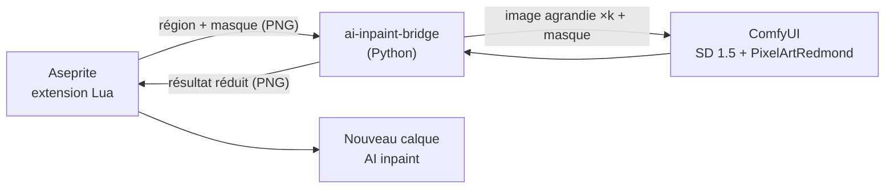

# aseprite-ai-inpaint

Extension Aseprite qui réécrit la zone sélectionnée d'un sprite avec un modèle de diffusion local (ComfyUI).

## État

Itération 3 : génération via ComfyUI (SD 1.5 + LoRA pixel art), transparence conservée, couleurs ramenées à la palette du sprite, sprites RGB et indexés.



Traitement dans le pont :

1. Les pixels transparents sont posés sur une couleur clé (magenta, vert, cyan ou jaune : celle qui est la plus éloignée des couleurs de la région) et le prompt reçoit `plain <couleur> background`.
2. La région est agrandie sans lissage (facteur entier, côté le plus long vers 512 px) et complétée jusqu'à un multiple de 8 pour l'espace latent.
3. Le résultat est ramené à la palette du sprite (ou à une palette adaptative de 16 couleurs si l'option est décochée ou si la palette n'a qu'une couleur), les pixels proches de la couleur clé redeviennent transparents.
4. Chaque bloc agrandi est réduit à un pixel par vote majoritaire.

## Prérequis

- Aseprite 1.3 (testé avec 1.3.18)
- ComfyUI installé dans `~/workspace/ComfyUI` (ou `COMFYUI_DIR`) avec :
  - `models/checkpoints/v1-5-pruned-emaonly-fp16.safetensors` ([Comfy-Org/stable-diffusion-1.5](https://huggingface.co/Comfy-Org/stable-diffusion-1.5))
  - `models/loras/PixelArtRedmond15V-PixelArt-PIXARFK.safetensors` ([artificialguybr/pixelartredmond-1-5v](https://huggingface.co/artificialguybr/pixelartredmond-1-5v-pixel-art-loras-for-sd-1-5))

## Installation

```bash
poetry install
```

```bash
./scripts/install-extension.sh
```

Le script crée `~/.config/aseprite/extensions/aseprite-ai-inpaint` avec un lien symbolique par fichier de `extension/` : les modifications du projet sont prises en compte au redémarrage d'Aseprite. Un lien symbolique sur le dossier entier ne fonctionne pas, Aseprite l'ignore. Le script préremplit aussi la commande du pont (modifiable dans **Edit > FX > AI Inpaint Settings...**).

Redémarrer Aseprite. Au premier lancement, Aseprite demande l'autorisation d'exécuter la commande : choisir « Allow ».

## Utilisation

1. Démarrer ComfyUI (laisser le terminal ouvert) :

   ```bash
   ./scripts/start-comfyui.sh
   ```

2. Ouvrir un sprite (RGB ou indexé) et sélectionner une zone.
3. **Edit > FX > AI Inpaint Selection**, saisir un prompt en anglais, la force de modification (100 % = la zone est entièrement redessinée) et choisir d'utiliser ou non la palette du sprite (toujours utilisée en mode indexé).
4. Le résultat arrive dans un nouveau calque `AI inpaint`, uniquement sur les pixels sélectionnés (une seule annulation pour tout défaire).

Le backend se choisit dans **AI Inpaint Settings...** : `comfyui` pour la génération, `invert` pour tester la plomberie sans IA.

## Développement

```bash
poetry run pytest
```

```bash
poetry run pylint src tests
```

```bash
poetry run black --check .
```

```bash
poetry run mypy src tests
```

Test d'aller-retour de l'extension, sans interface. Il affiche `ROUNDTRIP OK` en cas de succès ; Aseprite renvoie toujours le code 0, c'est donc ce message qui fait foi. Avec `backend=comfyui`, ComfyUI doit tourner :

```bash
aseprite -b --script-param bridge="$(poetry env info -p)/bin/ai-inpaint-bridge" --script-param backend=invert --script tests/roundtrip.lua
```

## Limites connues

- Mode niveaux de gris non pris en charge.
- Aseprite est figé pendant la génération (6 à 8 s sur une RTX 3050 Ti 4 Go).
- Le résultat varie beaucoup d'une seed à l'autre et l'objet généré est parfois plus petit que la sélection. Ajouter au prompt « single object, game sprite » n'a pas amélioré les résultats lors des essais.
- Le calque `AI inpaint` se superpose à l'original : un pixel rendu transparent n'efface pas ce qu'il y a dessous.
