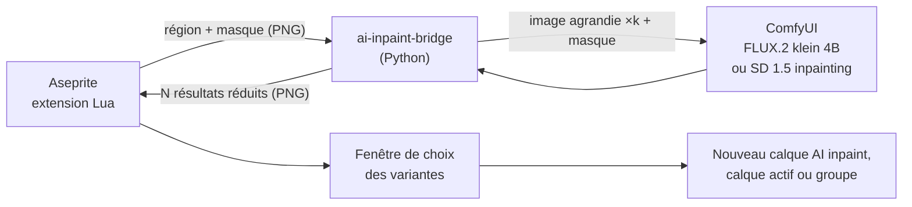
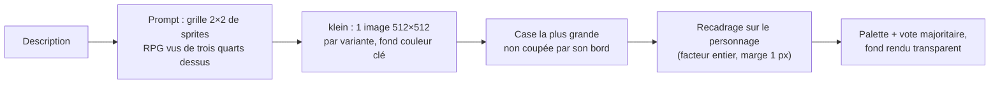

# aseprite-ai-inpaint

Extension Aseprite qui réécrit la zone sélectionnée d'un sprite, ou dessine un personnage depuis une description, avec un modèle de diffusion local (ComfyUI).

## État

Itération 7 : tâche `character` (personnage vu de dessus sur fond transparent, **Edit > AI > Generate Character**) en plus de la retouche. Tâches choisies avec `--task`, sous-menu **Edit > AI**, FLUX.2 klein 4B distillé comme modèle par défaut, SD 1.5 inpainting en repli pour la retouche.



Traitement dans le pont :

1. Les pixels transparents sont posés sur une couleur clé (magenta, vert, cyan ou jaune : celle qui est la plus éloignée des couleurs de la région).
2. Le masque envoyé au modèle est élargi de 2 pixels : sans cela, le modèle d'inpainting dessine souvent un cadre le long du bord du masque. Seule la sélection d'origine est ensuite conservée.
3. La région est agrandie sans lissage (facteur entier, côté le plus long vers 512 px) et complétée jusqu'à un multiple de 8 pour l'espace latent.
4. Le résultat est ramené à la palette du sprite (ou à une palette adaptative de 16 couleurs si l'option est décochée ou si la palette n'a qu'une couleur), les pixels proches de la couleur clé redeviennent transparents.
5. Chaque bloc agrandi est réduit à un pixel par vote majoritaire.

### Modèle de la retouche

Par défaut, la retouche utilise FLUX.2 klein 4B distillé (`--model klein-4b`, ou **Inpaint model** dans **Edit > AI > Settings...**) :

- le latent de l'image reçoit un masque de bruit (`SetLatentNoiseMask`) et l'image d'origine est donnée en référence au prompt (`ReferenceLatent`) ;
- 4 étapes, CFG 1, `euler`, prompt préfixé par `pixel art` (sans le déclencheur de la LoRA de SD 1.5) ;
- la force de modification fixe le point de départ du planning de FLUX.2 : à 100 %, le planning complet ; en dessous, le modèle part d'une image partiellement bruitée. Le pont calcule lui-même les niveaux de bruit (`ManualSigmas`), si bien que chaque force échantillonne 4 étapes, dure le même temps et donne un résultat distinct ; une force nulle est refusée.

Pourquoi klein (planches et détail dans le [compte rendu de l'issue 6](https://github.com/Sarcouy/aseprite-ai-plugin/issues/6#issuecomment-6632860704)) :

- il suit mieux le prompt : la fiole, le slime, le sapin et l'épée du banc sont meilleurs qu'avec SD 1.5 ;
- le coffre reste meilleur avec SD 1.5 : klein remplit toute la sélection avec un sujet trop détaillé pour 16 px ;
- il est deux fois plus lent : environ 41 s pour 4 variantes, contre 21,5 s ;
- la génération reste à 512 px pour privilégier la qualité ; à 256 px, 4 variantes prennent 18 s.

SD 1.5 (`--model sd15-inpaint`) reste disponible en repli : UNet de `sd-v1-5-inpainting` (nœuds `UNETLoader` et `InpaintModelConditioning`) avec le CLIP et le VAE du checkpoint SD 1.5, la LoRA PixelArtRedmond et une CFG de 10.

### Tâches

Le pont exécute une tâche choisie avec `--task` : `inpaint` (la retouche, tâche par défaut) ou `character` (voir [Génération de personnage](#génération-de-personnage)). Chaque tâche est un module de `src/ai_inpaint_bridge/tasks/` qui déclare ses options, son modèle de base (graphe ComfyUI et réglages par défaut) et son traitement. Une nouvelle tâche s'ajoute au registre `TASKS` de `tasks/__init__.py` et à la table `task_entries` de `extension/plugin.lua`, qui crée sa commande dans le sous-menu **Edit > AI**. Les options `--output`, `--backend`, `--model`, `--prompt`, `--seed`, `--variants`, `--palette` et `--comfyui-url` sont communes à toutes les tâches ; `--model` prend le premier modèle de la tâche par défaut.

Avec `--variants N` (1 à 8), le latent encodé est répété N fois (nœud `RepeatLatentBatch`) et échantillonné en un seul passage : chaque élément du batch reçoit un bruit différent. Le pont écrit `<sortie>-1.png` à `<sortie>-N.png`.

Mesures avec SD 1.5 sur RTX 3050 Ti 4 Go (ComfyUI en `--lowvram`, région 32×32 agrandie à 512×512) ; avec klein, 4 variantes en batch prennent environ 41 s :

| Variantes | Batch | N prompts successifs | Pic de VRAM (batch / successifs) |
|-----------|-------|----------------------|----------------------------------|
| 4 | 21,5 s | 19,6 s | 2983 / 2983 Mio |
| 8 | 43,2 s | 47,9 s | 3143 / 2727 Mio |

## Prérequis

- Aseprite 1.3 (testé avec 1.3.18)
- ComfyUI installé dans `~/workspace/ComfyUI` (ou `COMFYUI_DIR`) avec, pour klein :
  - `models/diffusion_models/flux-2-klein-4b-fp8.safetensors` ([black-forest-labs/FLUX.2-klein-4b-fp8](https://huggingface.co/black-forest-labs/FLUX.2-klein-4b-fp8))
  - `models/text_encoders/qwen_3_4b_fp8_mixed.safetensors` ([Comfy-Org/Z-Image-Turbo](https://huggingface.co/Comfy-Org/Z-Image-Turbo))
  - `models/vae/flux2-vae.safetensors` ([Comfy-Org/Flux-2-Klein-4B](https://huggingface.co/Comfy-Org/Flux-2-Klein-4B))
- et, pour le modèle de repli SD 1.5 :
  - `models/checkpoints/v1-5-pruned-emaonly-fp16.safetensors` ([Comfy-Org/stable-diffusion-1.5](https://huggingface.co/Comfy-Org/stable-diffusion-1.5))
  - `models/loras/PixelArtRedmond15V-PixelArt-PIXARFK.safetensors` ([artificialguybr/pixelartredmond-1-5v](https://huggingface.co/artificialguybr/pixelartredmond-1-5v-pixel-art-loras-for-sd-1-5))
  - `models/diffusion_models/sd-v1-5-inpainting-unet-fp16.safetensors` : fichier `unet/diffusion_pytorch_model.fp16.safetensors` de [stable-diffusion-v1-5/stable-diffusion-inpainting](https://huggingface.co/stable-diffusion-v1-5/stable-diffusion-inpainting), renommé (1,7 Go)

## Installation

```bash
poetry install
```

```bash
./scripts/install-extension.sh
```

Le script crée `~/.config/aseprite/extensions/aseprite-ai-inpaint` avec un lien symbolique par fichier de `extension/` : les modifications du projet sont prises en compte au redémarrage d'Aseprite. Un lien symbolique sur le dossier entier ne fonctionne pas, Aseprite l'ignore. Le script préremplit aussi la commande du pont (modifiable dans **Edit > AI > Settings...**).

Redémarrer Aseprite. Au premier lancement, Aseprite demande l'autorisation d'exécuter la commande : choisir « Allow ».

### Génération de personnage

La tâche `character` dessine un personnage depuis une description (`--prompt`), à la taille `--size` (`N` ou `LxH`, jusqu'à 64 px), sans image d'entrée. Elle n'utilise que klein distillé.



1. La description est placée dans un gabarit : `a 2 by 2 grid of four separate top-down RPG overworld game sprites of <description>, three-quarter view from above, full body, small and simple, evenly spaced`, suivi de `plain <couleur clé> background`.
2. Chaque variante est une image 512×512 générée en batch. Dessinés en petit dans une grille, les sprites sont plus simples (aplats, contour net) et gardent leur forme une fois réduits.
3. Dans chaque image, la case retenue est celle qui contient le plus grand sprite sans toucher son bord ; si aucune ne convient (le modèle n'a pas dessiné de grille), l'image entière est utilisée. Les 4 cases d'une même image se ressemblent beaucoup : les variantes viennent d'images distinctes.
4. Le fond est la couleur médiane du bord de la case. La case est recadrée autour du personnage, avec un facteur entier choisi pour qu'il occupe toute la hauteur ou la largeur du sprite moins 1 pixel de marge.
5. Comme pour la retouche, le résultat est ramené à la palette, les pixels proches du fond deviennent transparents et chaque bloc est réduit par vote majoritaire.

Aucune LoRA n'est utilisée, contrairement à ce que proposait l'issue : la LoRA Limbicnation n'a pas d'effet visible avec klein distillé et la LoRA svntax ne produit que des planches de marche, sur klein base (voir [Modèles récents sur 4 Go de VRAM](#modèles-récents-sur-4-go-de-vram)).

## Utilisation

1. Démarrer ComfyUI (laisser le terminal ouvert) :

   ```bash
   ./scripts/start-comfyui.sh
   ```

2. Ouvrir un sprite (RGB ou indexé) et sélectionner une zone.
3. **Edit > AI > Inpaint Selection**, saisir :
   - un prompt en anglais ;
   - la force de modification (100 % = la zone est entièrement redessinée ; avec klein, garder au moins 80 % pour changer la matière d'un dessin existant) ;
   - l'utilisation ou non de la palette du sprite (toujours utilisée en mode indexé) ;
   - le nombre de variantes (1 à 8) ;
   - la sortie : `New layer` (nouveau calque `AI inpaint`) ou `Active layer` (le calque actif est modifié, les pixels transparents du résultat effacent l'original ; sur un calque de fond, ils prennent la couleur d'arrière-plan, comme avec la gomme).
4. La génération tourne en arrière-plan (environ 10 s par variante avec klein sur une RTX 3050 Ti 4 Go) : Aseprite reste utilisable et une fenêtre affiche le temps écoulé. **Cancel**, ou la fermeture de cette fenêtre, arrête le pont et la génération en cours dans ComfyUI ; rien n'est appliqué. Une seule génération à la fois est possible. Si le sprite, l'image ou le calque actif visé a été supprimé entre-temps, le résultat est abandonné avec un message.
5. Avec plusieurs variantes, une fenêtre les affiche sur la région d'origine : cliquer sur une variante puis **Apply**, ou **Keep all as layers** pour obtenir un groupe `AI inpaint` avec un calque par variante (seule la première est visible). **Cancel** n'applique rien.
6. Seuls les pixels sélectionnés sont modifiés (ceux de la sélection au lancement), en une seule annulation.

Pour dessiner un personnage, **Edit > AI > Generate Character** (disponible sans sprite ouvert), puis saisir :

- une description en anglais, par exemple `a knight with a blue cape` ou `an orange tabby cat` ;
- la taille : 16, 24, 32, 48 ou 64 px de côté ;
- l'utilisation ou non de la palette du sprite actif (toujours utilisée en mode indexé) ;
- le nombre de variantes (1 à 8 ; en 32×32 sur une RTX 3050 Ti 4 Go, environ 12 s pour 1 variante et 26 s pour 4) ;
- la sortie : `New layer` (calque `AI character` centré sur la sélection, ou sur le canevas sans sélection) ou `New sprite` (nouveau sprite RGB à la taille du personnage, avec la palette du sprite actif ou, sans sprite, celle des couleurs du résultat). Sans sprite ouvert, la sortie est toujours `New sprite`.

La fenêtre de choix est la même que pour la retouche ; une variante vide y est barrée en rouge.

Le backend se choisit dans **Edit > AI > Settings...** : `comfyui` pour la génération, `invert` pour tester la plomberie sans IA (la tâche `character` y dessine un carré de la première couleur de la palette).

## Développement

```bash
poetry run pytest
```

```bash
poetry run pylint src tests
```

```bash
poetry run black --check .
```

```bash
poetry run mypy src tests
```

Test d'aller-retour de l'extension, sans interface (génération de plusieurs variantes, en mode bloquant puis en arrière-plan, annulation d'un pont lent, nouveau calque, groupe de variantes, calque actif). En mode batch aucun `Timer` ne tourne : le test interroge la génération en arrière-plan dans une boucle. La fenêtre de progression et la fenêtre de choix des variantes ne peuvent être testées qu'à la main. Il affiche `ROUNDTRIP OK` en cas de succès ; Aseprite renvoie toujours le code 0, c'est donc ce message qui fait foi. Avec `backend=comfyui`, ComfyUI doit tourner :

```bash
aseprite -b --script-param bridge="$(poetry env info -p)/bin/ai-inpaint-bridge" --script-param backend=invert --script-param mode=rgb --script-param variants=3 --script tests/roundtrip.lua
```

Paramètres : `backend` (`invert` ou `comfyui`), `mode` (`rgb` ou `indexed`), `variants` (2 par défaut).

### Banc d'évaluation

`ai-inpaint-bench` génère des cas fixes en palette DB32, avec une seed fixe, et produit une planche avec une ligne par cas. ComfyUI doit tourner.

Cas de retouche : 10 scènes.

- Dessin dans une zone vide : potion, coffre, slime, sapin, épée.
- Retouche d'un rocher entier ou d'une moitié de rocher, pour vérifier la jonction avec le dessin hors sélection.
- Retouche d'un chevalier 32×32 (`bench_sprites/knight.png`, dessiné par klein) à 80 % : cape rouge (`knight-cape`), lunettes noires (`knight-glasses`), épée tenue dans la main (`knight-sword`).

La ligne montre la région d'origine puis chaque variante, avec la part des pixels sélectionnés modifiés. `--denoise` impose une même force de modification à ces 10 cas (entre 0 exclu et 1).

Retouche d'un dessin existant avec klein : ajouter de la mousse au rocher (« mossy rock », [issue 7](https://github.com/Sarcouy/aseprite-ai-plugin/issues/7)). Une variante est comptée réussie si au moins 8 % des pixels opaques sélectionnés sont verts (teinte de 55 à 170°, saturation au-dessus de 0,25) et si la silhouette recouvre celle d'origine à 90 % (IoU de l'alpha). Variantes réussies sur 4, aux seeds 1000, 2000 et 3000 (les lignes marquées \* ont été mesurées avant la force continue, à un niveau de bruit de départ de 0,91 au lieu de 0,92 pour 60 %) :

| Réglage | `rock` (rocher entier) | `rock-cut` (moitié droite) |
|---|---|---|
| Force 60 % (`rock`), 80 % (`rock-cut`) | 0, 2, 0 | 1, 2, 1 |
| Force 80 % | 3, 3, 2 | 1, 2, 1 |
| Force 100 % | forme perdue (blocs carrés) | 2, 1 sur 2 seeds, silhouette souvent débordante |
| CFG 2 \* | 0, 2 sur 2 seeds | 3, 2 sur 2 seeds |
| Consigne « add green moss patches on the rock » \* | 0, 1 sur 2 seeds | 1, 0 sur 2 seeds |
| Sans l'image en référence (`ReferenceLatent`) \* | 2, 2 sur 2 seeds | 0, 0 sur 2 seeds, silhouette perdue |
| klein base \* | 0, 0 sur 2 seeds | 0, 0 sur 2 seeds |

Le niveau de bruit de départ décide presque seul : autour de 0,92 (force 60 %), klein recopie l'image de référence ; autour de 0,97 (force 80 %), il ajoute la matière demandée en gardant la forme ; à 0,98 et au-delà, la forme commence à se perdre. Niveau de bruit de départ selon la force, pour une image de 512×512 : 30 % → 0,77, 50 % → 0,88, 60 % → 0,92, 70 % → 0,95, 80 % → 0,97, 90 % → 0,99, 100 % → 1.

Retouche du chevalier à 80 %, seeds 1000 et 2000, 4 variantes :

| Cas | Résultat |
|---|---|
| `knight-cape` | cape rouge sur 4 variantes sur 4 aux deux seeds, silhouette gardée ; quelques touches orange |
| `knight-glasses` | bandeau noir sur les yeux sur 2 variantes sur 4 (seed 1000), 1 à 2 (seed 2000) ; à 32 px, des lunettes se réduisent à ce bandeau |
| `knight-sword` | épée ajoutée sur 3 variantes sur 4 (seed 1000) et 4 sur 4 (seed 2000), le plus souvent en diagonale depuis la main |

Pour ajouter un objet à côté d'un personnage, le cadrage compte : l'extension n'envoie que la sélection et une marge (8 px par défaut). Avec le chevalier entier envoyé (même seed, même force), klein n'ajoute aucune épée et recopie l'image de référence. Dans ce même essai sur le chevalier entier, la cape et les lunettes changent peu à 60 %, comme le rocher.

Cas générés depuis le prompt seul :

| Cas | Taille | Rendu sur la planche |
|-----|--------|----------------------|
| `knight-16`, `knight-32` | chevalier à cape bleue de la tâche `character`, 16×16 et 32×32 | sur fond transparent |
| `cat-16`, `cat-32` | chat roux de la tâche `character`, 16×16 et 32×32 | sur fond transparent |
| `grass-tile`, `wall-tile` | tile d'herbe et de mur, 16×16 | répétée 3×3 pour voir les raccords |
| `knight-walk` | planche de marche 128×128 : 4 directions × 4 images de 32×32, prompt rédigé comme sur la fiche de la LoRA svntax | sur fond transparent |

Les cas de personnage passent par le même code que la tâche `character` : leur prompt est la description, placée dans son gabarit. Les autres cas sont générés à 512 px puis réduits par vote majoritaire. Un sprite transparent est demandé sur une couleur clé citée dans le prompt. Le modèle ne fait que l'approcher : klein dessine « magenta » en rose plus ou moins rouge. Le fond retiré est donc la couleur médiane mesurée sur le bord de chaque image.

Résultats avec klein distillé, seed 1000, 4 variantes par cas :

| Cas | Résultat |
|-----|----------|
| `knight-32`, `cat-32` | voir le tableau des personnages ci-dessous |
| `knight-16`, `cat-16` | voir le tableau des personnages ci-dessous |
| `grass-tile` | 2 variantes texturées sans couture visible, 2 unies |
| `wall-tile` | aucune brique : 1 variante unie, 3 en bruit gris |

Personnages selon le gabarit de prompt et le traitement, klein distillé, seeds 1000 et 2000, 4 variantes par seed (8 par case du tableau) :

| Gabarit, traitement | 32×32 (`knight-32`, `cat-32`) | 16×16 (`knight-16`, `cat-16`) |
|---------------------|-------------------------------|-------------------------------|
| initial : `top-down view, …, full body, single character, centered`, image entière | 8/8 lisibles, de face ; le chat se tient debout comme un humain | chevalier en taches de couleur ; chat réduit à un bloc orange debout |
| RPG trois quarts dessus, image entière | 8/8 lisibles ; chat à quatre pattes | personnage petit (environ 10 px de haut) : chat reconnaissable, chevalier confus |
| vue de dessus stricte (`seen from directly above, bird's-eye view`) | chevalier vu d'en haut (casque et cape) ; chat réduit à une tête | non mesuré |
| RPG trois quarts dessus, recadré | 8/8 lisibles, plus grands | plus grands : chat lisible, chevalier encore confus |
| **grille 2×2, meilleure case, recadrée (retenu)** | **8/8 lisibles**, contours nets et aplats | **chat lisible, chevalier reconnaissable** à son casque et sa cape bleue |

La vue de dessus stricte n'est suivie que pour le chevalier, et des variantes du prompt (« whole body seen from above », « top-down shooter ») retombent sur une vue de face. Le gabarit retenu vise donc la vue de trois quarts dessus des RPG, la convention des jeux top-down pour les personnages. Une grille 2×2 seule (1 image, 4 cases) donne 4 fois presque le même personnage, d'où une image par variante. Générer à 256 px au lieu de 512 ne change rien de visible en 16×16 (seule taille mesurée). Ajouter `no shadow` au prompt n'enlève pas les rares pixels roses : comptés sur le rose de DB32 (215, 123, 186), au plus 4 pixels sur 4 variantes 32×32 sans l'ajout, 7 avec ; à l'œil, ce sont surtout le nez et les oreilles du chat.

Une grille 4×4 (16 cases, 16×16) est bien dessinée par klein, mais pas toujours alignée sur les quarts de l'image : le découpage tombe alors entre les sprites (3 variantes vides ou en morceaux sur 16), et les cases réussies ne valent pas mieux que celles de la grille 2×2.

En 64×64 (seeds 1000 et 2000), la grille 2×2 et l'image seule recadrée donnent toutes deux 8 variantes lisibles sur 8 : l'image seule est plus détaillée (pelage nuancé, reflets de l'armure), la grille donne un dessin plus simple aux contours plus nets. La grille est gardée à toutes les tailles.

Planche de marche (`knight-walk`, seed 1000, 4 variantes) selon le modèle et la LoRA [svntax](https://huggingface.co/svntax-dev/pixel_spritesheet_4walk_small_lora_v1), entraînée sur klein base :

| Modèle | LoRA | Temps | Résultat |
|--------|------|-------|----------|
| klein distillé | aucune | 28 s | grilles 2×2, une seule direction |
| klein distillé | svntax | 29 s | 2 variantes sur 4 en 4 lignes × 2 colonnes avec les 4 directions, les autres en 2×2 ; pas de cycle de marche |
| klein base | aucune | 203 s | grilles 3×3 ou 2×3, pas de directions |
| klein base | svntax | 221 s | 4 variantes sur 4 en 4×4 : face, gauche, droite, dos dans l'ordre demandé ; poses de marche qui varient d'une image à l'autre, sans cycle régulier ; la 4e image de chaque ligne s'écarte souvent du reste, cape bleu-gris plutôt que bleue |

Seul klein base avec la LoRA svntax produit une planche de marche exploitable, à reprendre à la main pour le cycle. C'est le meilleur candidat pour une future tâche de planche de marche, au prix de 221 s pour 4 variantes, environ 67 s pour une seule (voir le tableau des modèles).

`--model` choisit le modèle : ceux de la retouche (klein distillé par défaut, `sd15-inpaint`) et `klein-4b-base`, réservé au banc (20 étapes, CFG 5, prompt négatif vide). Ses réglages s'appliquent, sauf ceux donnés en option. `--lora` ajoute une LoRA (fichier de `models/loras/` de ComfyUI), avec la force `--lora-strength` ; avec klein, elle ne s'applique qu'au modèle de diffusion. `--cases` limite la planche à quelques cas. Comparer deux réglages revient à comparer deux planches :

```bash
poetry run ai-inpaint-bench --output bench.png
```

```bash
poetry run ai-inpaint-bench --model sd15-inpaint --inpaint-model "" --cfg 7 --mask-grow 0 --background-hint --seed 2000 --output ancien.png
```

Résultats des essais avec SD 1.5 (seeds 1000 et 2000, 4 variantes par scène) :

| Réglage | Effet |
|---------|-------|
| UNet d'inpainting au lieu du checkpoint | objets plus nets et reconnaissables, plus de débris autour de l'objet, mais des cadres le long du masque |
| Masque élargi de 2 px | plus de cadres, objets qui remplissent la sélection, presque plus de variantes vides |
| Pas de `plain <couleur> background` dans le prompt | couleurs demandées mieux respectées (potions rouges) |
| CFG 10 au lieu de 7 | objets plus proches du prompt (coffres, sapins) |
| LoRA à 0,6 | pas de gain |
| `dpmpp_2m` / karras, 30 étapes | moins bon |

### Modèles récents sur 4 Go de VRAM

Mesures de génération texte vers image à 512×512 sur RTX 3050 Ti 4 Go, avec ComfyUI 0.43 en `--lowvram`. Seul klein 4B distillé est branché dans le pont, pour la retouche.

Conditions de mesure :

- Profil d'énergie `performance`, sur secteur. Avec le profil `balanced`, le GPU est limité à 20 W et tourne à 210 MHz : tous les temps sont multipliés par 4 à 5.
- GPU à 40 W, de 900 à 1200 MHz, de 75 à 88 °C.
- Encodeur de texte Qwen3 4B en fp8 (`qwen_3_4b_fp8_mixed`), commun aux trois modèles.
- « À chaud » : médiane de 3 générations, modèle déjà chargé. « À froid » : juste après le déchargement des modèles (`/free`), fichiers probablement encore dans le cache disque du système.
- Pic de VRAM relevé par `nvidia-smi` toutes les 0,2 s, mémoire réservée par PyTorch comprise.

| Modèle | Réglages | 1 image à chaud | 1 image à froid | 4 images | LoRA, 1 image | LoRA, 4 images | Pic de VRAM |
|--------|----------|-----------------|-----------------|----------|---------------|----------------|-------------|
| FLUX.2 klein 4B distillé | fp8, 4 étapes, CFG 1, `euler` | 9,6 s | 10,9 s | 25,8 s | 12,9 s | 28,9 s | 3759 Mio |
| Z-Image Turbo | int8 convrot, 8 étapes, CFG 1, `res_multistep` | 25,7 s | 29,6 s | 77,3 s | 49,2 s | 111,2 s | 3633 Mio |
| FLUX.2 klein 4B base | fp8, 20 étapes, CFG 5, `euler` | 57,7 s | 66,3 s | 205,2 s | 67,1 s | non mesuré | 3503 Mio |

Aucune génération n'a manqué de mémoire. Le changement de modèle coûte 1 à 9 s de plus que la génération à chaud, mesuré juste après une autre génération : les fichiers étaient probablement encore dans le cache disque. Depuis le disque, il faut compter davantage.

Sur 31 Go de RAM, il reste au plus bas 3,4 Go de libre (Z-Image avec LoRA, Firefox ouvert) : la RAM est la contrainte suivante après la VRAM. L'encodeur en fp4 (`qwen_3_4b_fp4_mixed`, 3,5 Go au lieu de 5,3) libère de la RAM sans changer la vitesse.

LoRA testées :

| LoRA | Modèle | Effet |
|------|--------|-------|
| [Limbicnation/pixel-art-lora](https://huggingface.co/Limbicnation/pixel-art-lora) | klein distillé | presque aucun effet à même prompt et même seed (contours un peu plus nets) ; 6 clés de modulation ignorées par ComfyUI, 63 appliquées |
| [svntax-dev/pixel_spritesheet_4walk_small_lora_v1](https://huggingface.co/svntax-dev/pixel_spritesheet_4walk_small_lora_v1) | klein base | produit une planche 4×4 de marche, son usage prévu, inutilisable pour un sprite seul ; avec le prompt de sa fiche, planche exploitable (voir le banc) |
| [Pixel Art Style](https://civitai.com/models/1770073) (Civitai, déclencheur `Pixel Art style.`) | Z-Image Turbo | sujets plus détaillés et moins simplistes, grille de pixels plus fine (prompt préfixé par le déclencheur) ; double le temps de génération |

Qualité (planche commune : chevalier, coffre, slime, potion, sapins, puits, magicien) :

- klein distillé : très bon suivi du prompt, objets détaillés, mais des dégradés et de l'anticrénelage qu'il faudra réduire à la palette ; vue de face plus que de dessus.
- Z-Image Turbo : le pixel art le plus franc (aplats, contours d'un pixel), le chevalier est simpliste.
- klein base : proche du distillé, plus lent ; le slime ressemble à un virus.

Modèle retenu : FLUX.2 klein 4B distillé, sans LoRA. Il est à la fois le plus rapide et le meilleur en qualité.

- Z-Image Turbo est écarté : son pixel art est plus franc, mais les sujets sont nettement moins bons que ceux de klein.
- klein base est écarté pour la retouche : six fois plus lent que le distillé, sans gain visible. Il reste dans le banc, seul modèle à tirer parti de la LoRA svntax pour les planches de marche.
- La LoRA Limbicnation est écartée : elle ajoute 3 s par génération sans effet visible.

Fichiers utilisés, dans `models/` de ComfyUI :

- `diffusion_models/flux-2-klein-4b-fp8.safetensors` ([black-forest-labs/FLUX.2-klein-4b-fp8](https://huggingface.co/black-forest-labs/FLUX.2-klein-4b-fp8))
- `diffusion_models/flux-2-klein-base-4b-fp8.safetensors` ([black-forest-labs/FLUX.2-klein-base-4b-fp8](https://huggingface.co/black-forest-labs/FLUX.2-klein-base-4b-fp8))
- `vae/flux2-vae.safetensors` ([Comfy-Org/Flux-2-Klein-4B](https://huggingface.co/Comfy-Org/Flux-2-Klein-4B))
- `diffusion_models/z_image_turbo_int8_convrot.safetensors`, `text_encoders/qwen_3_4b_fp8_mixed.safetensors` et `qwen_3_4b_fp4_mixed.safetensors`, `vae/z-image-ae.safetensors` (`ae.safetensors` renommé) ([Comfy-Org/Z-Image-Turbo](https://huggingface.co/Comfy-Org/Z-Image-Turbo))
- `loras/klein4b-base-pixel-4walk-svntax.safetensors` (LoRA de [svntax-dev/pixel_spritesheet_4walk_small_lora_v1](https://huggingface.co/svntax-dev/pixel_spritesheet_4walk_small_lora_v1), renommée)

## Limites connues

- Mode niveaux de gris non pris en charge.
- Le lancement en arrière-plan passe par `sh` et `kill` : Linux et macOS seulement.
- **Cancel** arrête le processus lancé par la commande du pont : elle doit être le chemin direct de `ai-inpaint-bridge` (celui écrit par le script d'installation). Avec une commande intermédiaire comme `poetry run ai-inpaint-bridge`, seule celle-ci serait arrêtée et la génération continuerait.
- Le modèle part de l'image au lancement : les retouches faites pendant la génération ne sont pas vues par le modèle, mais le résultat s'applique par-dessus.
- Le résultat varie encore d'une seed à l'autre : environ 3 variantes sur 4 sont utilisables sur le banc. La fenêtre de choix barre en rouge les variantes qui changent moins de 5 % des pixels sélectionnés.
- La retouche d'un dessin existant ne suit le prompt qu'à partir de 80 % de force avec klein : à 60 %, « mossy rock » n'ajoute presque jamais de mousse ; à 80 %, 2 à 3 variantes sur 4 en ont pour un rocher entier. Retoucher une moitié de dessin reste fragile (1 à 2 variantes sur 4) et la jonction avec la partie non sélectionnée se voit. SD 1.5 n'ajoute jamais de mousse.
- En sortie `New layer`, le calque `AI inpaint` se superpose à l'original : un pixel rendu transparent n'efface pas ce qu'il y a dessous. Utiliser `Active layer` pour effacer.
- Le modèle reçoit l'image aplatie de tous les calques visibles : en sortie `Active layer`, l'apparence des autres calques peut se retrouver dans le calque actif.
- Une variante issue d'un batch ne peut pas être régénérée seule à partir de la seed.
- Personnage : la vue est celle des RPG (trois quarts dessus, de face), pas une vue strictement de dessus ; une seule direction, pas d'animation. En 16×16, le chevalier reste approximatif (casque et cape reconnaissables, détails perdus). La taille est limitée à 64 px : chaque sprite est dessiné dans une case de 256 px de la grille, mesurée jusqu'à 64 px seulement.
- Personnage, sortie `New sprite` sans sprite ouvert : la palette est faite des couleurs du résultat, ramené à une palette adaptative de 16 couleurs.
