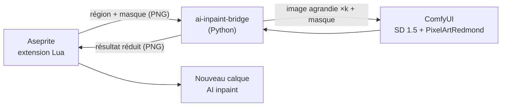

# aseprite-ai-inpaint

Extension Aseprite qui réécrit la zone sélectionnée d'un sprite avec un modèle de diffusion local (ComfyUI).

## État

Itération 2 : génération réelle via ComfyUI (SD 1.5 + LoRA pixel art). Le résultat est brut : pas encore de gestion de la transparence ni de la palette (itération 3).



Le pont agrandit la région sans lissage (facteur entier, côté le plus long vers 512 px), la complète jusqu'à un multiple de 8 pour l'espace latent, puis réduit le résultat en *nearest neighbor*. Les pixels transparents sont envoyés sur fond gris neutre.

## Prérequis

- Aseprite 1.3 (testé avec 1.3.18)
- ComfyUI installé dans `~/workspace/ComfyUI` (ou `COMFYUI_DIR`) avec :
  - `models/checkpoints/v1-5-pruned-emaonly-fp16.safetensors` ([Comfy-Org/stable-diffusion-1.5](https://huggingface.co/Comfy-Org/stable-diffusion-1.5))
  - `models/loras/PixelArtRedmond15V-PixelArt-PIXARFK.safetensors` ([artificialguybr/pixelartredmond-1-5v](https://huggingface.co/artificialguybr/pixelartredmond-1-5v-pixel-art-loras-for-sd-1-5))

## Installation

```bash
poetry install
```

```bash
./scripts/install-extension.sh
```

Le script crée `~/.config/aseprite/extensions/aseprite-ai-inpaint` avec un lien symbolique par fichier de `extension/` : les modifications du projet sont prises en compte au redémarrage d'Aseprite. Un lien symbolique sur le dossier entier ne fonctionne pas, Aseprite l'ignore. Le script préremplit aussi la commande du pont (modifiable dans **Edit > FX > AI Inpaint Settings...**).

Redémarrer Aseprite. Au premier lancement, Aseprite demande l'autorisation d'exécuter la commande : choisir « Allow ».

## Utilisation

1. Démarrer ComfyUI (laisser le terminal ouvert) :

   ```bash
   ./scripts/start-comfyui.sh
   ```

2. Ouvrir un sprite en mode RGB et sélectionner une zone.
3. **Edit > FX > AI Inpaint Selection**, saisir un prompt en anglais et la force de modification (100 % = la zone est entièrement redessinée).
4. Le résultat arrive dans un nouveau calque `AI inpaint`, uniquement sur les pixels sélectionnés (une seule annulation pour tout défaire).

Le backend se choisit dans **AI Inpaint Settings...** : `comfyui` pour la génération, `invert` pour tester la plomberie sans IA.

## Développement

```bash
poetry run pytest
```

```bash
poetry run pylint src tests
```

```bash
poetry run black --check .
```

```bash
poetry run mypy src tests
```

Test d'aller-retour de l'extension, sans interface. Il affiche `ROUNDTRIP OK` en cas de succès ; Aseprite renvoie toujours le code 0, c'est donc ce message qui fait foi. Avec `backend=comfyui`, ComfyUI doit tourner :

```bash
aseprite -b --script-param bridge="$(poetry env info -p)/bin/ai-inpaint-bridge" --script-param backend=invert --script tests/roundtrip.lua
```

## Limites connues

- Sprites en mode RGB uniquement (le mode indexé arrive avec la gestion de palette).
- Aseprite est figé pendant la génération (6 à 8 s sur une RTX 3050 Ti 4 Go).
- Les zones transparentes ressortent en gris opaque et les couleurs ne respectent pas la palette du sprite.
- Le modèle suit mal le prompt sur les petites zones.
