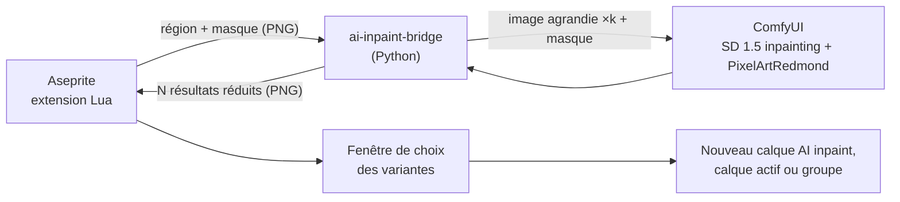

# aseprite-ai-inpaint

Extension Aseprite qui réécrit la zone sélectionnée d'un sprite avec un modèle de diffusion local (ComfyUI).

## État

Itération 5 : UNet spécialisé inpainting, masque élargi côté modèle, réglages choisis sur un banc d'évaluation, variantes ratées signalées dans la fenêtre de choix.



Traitement dans le pont :

1. Les pixels transparents sont posés sur une couleur clé (magenta, vert, cyan ou jaune : celle qui est la plus éloignée des couleurs de la région).
2. Le masque envoyé au modèle est élargi de 2 pixels : sans cela, le modèle d'inpainting dessine souvent un cadre le long du bord du masque. Seule la sélection d'origine est ensuite conservée.
3. La région est agrandie sans lissage (facteur entier, côté le plus long vers 512 px) et complétée jusqu'à un multiple de 8 pour l'espace latent.
4. Le résultat est ramené à la palette du sprite (ou à une palette adaptative de 16 couleurs si l'option est décochée ou si la palette n'a qu'une couleur), les pixels proches de la couleur clé redeviennent transparents.
5. Chaque bloc agrandi est réduit à un pixel par vote majoritaire.

ComfyUI utilise l'UNet de `sd-v1-5-inpainting` (nœuds `UNETLoader` et `InpaintModelConditioning`) avec le CLIP et le VAE du checkpoint SD 1.5, la LoRA PixelArtRedmond et une CFG de 10.

Le pont exécute une tâche choisie avec `--task` : seule `inpaint` (la retouche, tâche par défaut) existe pour l'instant. Chaque tâche est un module de `src/ai_inpaint_bridge/tasks/` qui déclare ses options, son modèle de base (graphe ComfyUI et réglages par défaut) et son traitement. Une nouvelle tâche s'ajoute au registre `TASKS` de `tasks/__init__.py` et à la table `task_entries` de `extension/plugin.lua`, qui crée sa commande dans le sous-menu **Edit > AI**. Les options `--output`, `--backend`, `--prompt`, `--seed`, `--variants`, `--palette` et `--comfyui-url` sont communes à toutes les tâches.

Avec `--variants N` (1 à 8), le latent encodé est répété N fois (nœud `RepeatLatentBatch`) et échantillonné en un seul passage : chaque élément du batch reçoit un bruit différent. Le pont écrit `<sortie>-1.png` à `<sortie>-N.png`.

Mesures sur RTX 3050 Ti 4 Go (ComfyUI en `--lowvram`, région 32×32 agrandie à 512×512) :

| Variantes | Batch | N prompts successifs | Pic de VRAM (batch / successifs) |
|-----------|-------|----------------------|----------------------------------|
| 4 | 21,5 s | 19,6 s | 2983 / 2983 Mio |
| 8 | 43,2 s | 47,9 s | 3143 / 2727 Mio |

## Prérequis

- Aseprite 1.3 (testé avec 1.3.18)
- ComfyUI installé dans `~/workspace/ComfyUI` (ou `COMFYUI_DIR`) avec :
  - `models/checkpoints/v1-5-pruned-emaonly-fp16.safetensors` ([Comfy-Org/stable-diffusion-1.5](https://huggingface.co/Comfy-Org/stable-diffusion-1.5))
  - `models/loras/PixelArtRedmond15V-PixelArt-PIXARFK.safetensors` ([artificialguybr/pixelartredmond-1-5v](https://huggingface.co/artificialguybr/pixelartredmond-1-5v-pixel-art-loras-for-sd-1-5))
  - `models/diffusion_models/sd-v1-5-inpainting-unet-fp16.safetensors` : fichier `unet/diffusion_pytorch_model.fp16.safetensors` de [stable-diffusion-v1-5/stable-diffusion-inpainting](https://huggingface.co/stable-diffusion-v1-5/stable-diffusion-inpainting), renommé (1,7 Go)

## Installation

```bash
poetry install
```

```bash
./scripts/install-extension.sh
```

Le script crée `~/.config/aseprite/extensions/aseprite-ai-inpaint` avec un lien symbolique par fichier de `extension/` : les modifications du projet sont prises en compte au redémarrage d'Aseprite. Un lien symbolique sur le dossier entier ne fonctionne pas, Aseprite l'ignore. Le script préremplit aussi la commande du pont (modifiable dans **Edit > AI > Settings...**).

Redémarrer Aseprite. Au premier lancement, Aseprite demande l'autorisation d'exécuter la commande : choisir « Allow ».

## Utilisation

1. Démarrer ComfyUI (laisser le terminal ouvert) :

   ```bash
   ./scripts/start-comfyui.sh
   ```

2. Ouvrir un sprite (RGB ou indexé) et sélectionner une zone.
3. **Edit > AI > Inpaint Selection**, saisir :
   - un prompt en anglais ;
   - la force de modification (100 % = la zone est entièrement redessinée) ;
   - l'utilisation ou non de la palette du sprite (toujours utilisée en mode indexé) ;
   - le nombre de variantes (1 à 8) ;
   - la sortie : `New layer` (nouveau calque `AI inpaint`) ou `Active layer` (le calque actif est modifié, les pixels transparents du résultat effacent l'original ; sur un calque de fond, ils prennent la couleur d'arrière-plan, comme avec la gomme).
4. Avec plusieurs variantes, une fenêtre les affiche sur la région d'origine : cliquer sur une variante puis **Apply**, ou **Keep all as layers** pour obtenir un groupe `AI inpaint` avec un calque par variante (seule la première est visible). **Cancel** n'applique rien.
5. Seuls les pixels sélectionnés sont modifiés, en une seule annulation.

Le backend se choisit dans **Edit > AI > Settings...** : `comfyui` pour la génération, `invert` pour tester la plomberie sans IA.

## Développement

```bash
poetry run pytest
```

```bash
poetry run pylint src tests
```

```bash
poetry run black --check .
```

```bash
poetry run mypy src tests
```

Test d'aller-retour de l'extension, sans interface (génération de plusieurs variantes, nouveau calque, groupe de variantes, calque actif). La fenêtre de choix des variantes ne peut être testée qu'à la main. Il affiche `ROUNDTRIP OK` en cas de succès ; Aseprite renvoie toujours le code 0, c'est donc ce message qui fait foi. Avec `backend=comfyui`, ComfyUI doit tourner :

```bash
aseprite -b --script-param bridge="$(poetry env info -p)/bin/ai-inpaint-bridge" --script-param backend=invert --script-param mode=rgb --script-param variants=3 --script tests/roundtrip.lua
```

Paramètres : `backend` (`invert` ou `comfyui`), `mode` (`rgb` ou `indexed`), `variants` (2 par défaut).

### Banc d'évaluation

`ai-inpaint-bench` génère 7 scènes fixes (potion, coffre, slime, sapin, épée, retouche d'un rocher entier ou d'une moitié de rocher, pour vérifier la jonction avec le dessin hors sélection) en palette DB32, avec une seed fixe, et produit une planche : une ligne par scène, la région d'origine puis chaque variante, avec la part des pixels sélectionnés modifiés. ComfyUI doit tourner. Comparer deux réglages revient à comparer deux planches :

```bash
poetry run ai-inpaint-bench --output bench.png
```

```bash
poetry run ai-inpaint-bench --inpaint-model "" --cfg 7 --mask-grow 0 --background-hint --seed 2000 --output ancien.png
```

Résultats des essais (seeds 1000 et 2000, 4 variantes par scène) :

| Réglage | Effet |
|---------|-------|
| UNet d'inpainting au lieu du checkpoint | objets plus nets et reconnaissables, plus de débris autour de l'objet, mais des cadres le long du masque |
| Masque élargi de 2 px | plus de cadres, objets qui remplissent la sélection, presque plus de variantes vides |
| Pas de `plain <couleur> background` dans le prompt | couleurs demandées mieux respectées (potions rouges) |
| CFG 10 au lieu de 7 | objets plus proches du prompt (coffres, sapins) |
| LoRA à 0,6 | pas de gain |
| `dpmpp_2m` / karras, 30 étapes | moins bon |

### Modèles récents sur 4 Go de VRAM

Mesures de génération texte vers image à 512×512 sur RTX 3050 Ti 4 Go, avec ComfyUI 0.43 en `--lowvram`. Aucun de ces modèles n'est encore branché dans le pont.

Conditions de mesure :

- Profil d'énergie `performance`, sur secteur. Avec le profil `balanced`, le GPU est limité à 20 W et tourne à 210 MHz : tous les temps sont multipliés par 4 à 5.
- GPU à 40 W, de 900 à 1200 MHz, de 75 à 88 °C.
- Encodeur de texte Qwen3 4B en fp8 (`qwen_3_4b_fp8_mixed`), commun aux trois modèles.
- « À chaud » : médiane de 3 générations, modèle déjà chargé. « À froid » : juste après le déchargement des modèles (`/free`), fichiers probablement encore dans le cache disque du système.
- Pic de VRAM relevé par `nvidia-smi` toutes les 0,2 s, mémoire réservée par PyTorch comprise.

| Modèle | Réglages | 1 image à chaud | 1 image à froid | 4 images | LoRA, 1 image | LoRA, 4 images | Pic de VRAM |
|--------|----------|-----------------|-----------------|----------|---------------|----------------|-------------|
| FLUX.2 klein 4B distillé | fp8, 4 étapes, CFG 1, `euler` | 9,6 s | 10,9 s | 25,8 s | 12,9 s | 28,9 s | 3759 Mio |
| Z-Image Turbo | int8 convrot, 8 étapes, CFG 1, `res_multistep` | 25,7 s | 29,6 s | 77,3 s | 49,2 s | 111,2 s | 3633 Mio |
| FLUX.2 klein 4B base | fp8, 20 étapes, CFG 5, `euler` | 57,7 s | 66,3 s | 205,2 s | 67,1 s | non mesuré | 3503 Mio |

Aucune génération n'a manqué de mémoire. Le changement de modèle coûte 1 à 9 s de plus que la génération à chaud, mesuré juste après une autre génération : les fichiers étaient probablement encore dans le cache disque. Depuis le disque, il faut compter davantage.

Sur 31 Go de RAM, il reste au plus bas 3,4 Go de libre (Z-Image avec LoRA, Firefox ouvert) : la RAM est la contrainte suivante après la VRAM. L'encodeur en fp4 (`qwen_3_4b_fp4_mixed`, 3,5 Go au lieu de 5,3) libère de la RAM sans changer la vitesse.

LoRA testées :

| LoRA | Modèle | Effet |
|------|--------|-------|
| [Limbicnation/pixel-art-lora](https://huggingface.co/Limbicnation/pixel-art-lora) | klein distillé | presque aucun effet à même prompt et même seed (contours un peu plus nets) ; 6 clés de modulation ignorées par ComfyUI, 63 appliquées |
| [svntax-dev/pixel_spritesheet_4walk_small_lora_v1](https://huggingface.co/svntax-dev/pixel_spritesheet_4walk_small_lora_v1) | klein base | testée avec un prompt générique et non celui de sa fiche : produit une planche 4×4 de marche, son usage prévu, inutilisable pour un sprite seul |
| [Pixel Art Style](https://civitai.com/models/1770073) (Civitai, déclencheur `Pixel Art style.`) | Z-Image Turbo | sujets plus détaillés et moins simplistes, grille de pixels plus fine (prompt préfixé par le déclencheur) ; double le temps de génération |

Qualité (planche commune : chevalier, coffre, slime, potion, sapins, puits, magicien) :

- klein distillé : très bon suivi du prompt, objets détaillés, mais des dégradés et de l'anticrénelage qu'il faudra réduire à la palette ; vue de face plus que de dessus.
- Z-Image Turbo : le pixel art le plus franc (aplats, contours d'un pixel), le chevalier est simpliste.
- klein base : proche du distillé, plus lent ; le slime ressemble à un virus.

Modèle retenu : FLUX.2 klein 4B distillé, sans LoRA. Il est à la fois le plus rapide et le meilleur en qualité.

- Z-Image Turbo est écarté : son pixel art est plus franc, mais les sujets sont nettement moins bons que ceux de klein.
- klein base est écarté : six fois plus lent que le distillé, sans gain visible.
- La LoRA Limbicnation est écartée : elle ajoute 3 s par génération sans effet visible.

Fichiers utilisés, dans `models/` de ComfyUI :

- `diffusion_models/flux-2-klein-4b-fp8.safetensors` ([black-forest-labs/FLUX.2-klein-4b-fp8](https://huggingface.co/black-forest-labs/FLUX.2-klein-4b-fp8))
- `diffusion_models/flux-2-klein-base-4b-fp8.safetensors` ([black-forest-labs/FLUX.2-klein-base-4b-fp8](https://huggingface.co/black-forest-labs/FLUX.2-klein-base-4b-fp8))
- `vae/flux2-vae.safetensors` ([Comfy-Org/Flux-2-Klein-4B](https://huggingface.co/Comfy-Org/Flux-2-Klein-4B))
- `diffusion_models/z_image_turbo_int8_convrot.safetensors`, `text_encoders/qwen_3_4b_fp8_mixed.safetensors` et `qwen_3_4b_fp4_mixed.safetensors`, `vae/z-image-ae.safetensors` (`ae.safetensors` renommé) ([Comfy-Org/Z-Image-Turbo](https://huggingface.co/Comfy-Org/Z-Image-Turbo))

## Limites connues

- Mode niveaux de gris non pris en charge.
- Aseprite est figé pendant la génération (6 à 8 s par variante sur une RTX 3050 Ti 4 Go).
- Le résultat varie encore d'une seed à l'autre : environ 3 variantes sur 4 sont utilisables sur le banc. La fenêtre de choix barre en rouge les variantes qui changent moins de 5 % des pixels sélectionnés.
- La retouche d'un dessin existant (force de modification à 60 %) suit mal le prompt : « mossy rock » n'a jamais ajouté de mousse lors des essais.
- En sortie `New layer`, le calque `AI inpaint` se superpose à l'original : un pixel rendu transparent n'efface pas ce qu'il y a dessous. Utiliser `Active layer` pour effacer.
- Le modèle reçoit l'image aplatie de tous les calques visibles : en sortie `Active layer`, l'apparence des autres calques peut se retrouver dans le calque actif.
- Une variante issue d'un batch ne peut pas être régénérée seule à partir de la seed.
